

# Bee Wing Lab: computer vision for bumblebee wing morphometrics

**A Windows desktop application that turns raw specimen photographs into analysis-ready wing-landmark coordinates: OpenCV marker-based perspective correction, a human-in-the-loop fallback, and DeepLabCut pose estimation in an isolated process.**

`Python` · `OpenCV` · `PySide6 / Qt 6` · `DeepLabCut 3` · `PyTorch` · `pytest` · `PyInstaller`

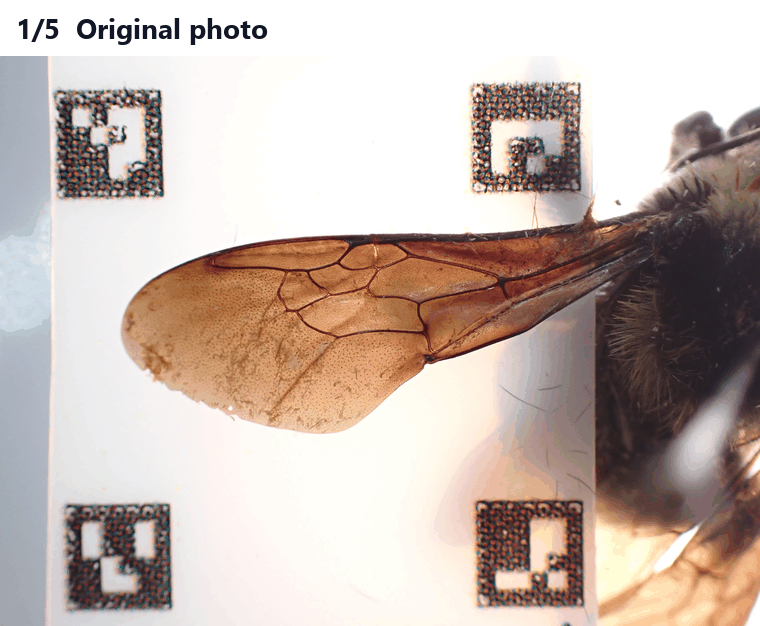

A real bumblebee left forewing going through the real pipeline: original photo → markers found → perspective-corrected → standardized → 13 landmarks predicted by the trained model (model output, not validated ground truth).

---

## The 60-second version

| | |
|---|---|
| **Problem** | Wing-shape studies need the same anatomical points measured on hundreds of specimen photos. The photos are hand-held, so they are tilted, at different scales, and a mix of left and right wings. Marking points by hand is slow and inconsistent. |
| **What I built** | A four-step pipeline and desktop app: **(1)** detect ArUco markers and warp each photo to a fixed-scale square, **(2)** send any photo the detector can't handle to a fast manual 4-click correction queue, **(3)** put left and right wings in the same orientation, **(4)** run a deep-learning pose model that writes 13 landmark coordinates per wing to CSV. |
| **Hard parts** | Keeping the UI responsive during multi-minute PyTorch inference. Never losing or duplicating a measurement across crashes, restarts and re-runs. Shipping all of it to lab computers with no Python installed. |
| **Evidence** | **1,248** automated tests. In the last full gate, **1,229 passed and 0 failed**, including 29 that launch the packaged executables. The new desktop app's outputs were proven **byte-identical** (SHA-256) to the original app's on every image and CSV. The packaged build checks itself and **refuses to ship** if it doesn't match its source. |
| **Status** | Release candidate `2.0.0-rc1`, built and verified. One step remains: a clean-machine acceptance run on a second computer. |

> **About this repository.** This is a public portfolio. One approved pair of real forewing photos (left and right of the same specimen) is shown, with the application's genuine outputs for that pair. Specimen identifiers and image metadata have been removed. Every other image is synthetic. The production source code, all other research images, the training data and labels, the trained model weights and all scientific results are **private**.

---

## A real specimen, end to end

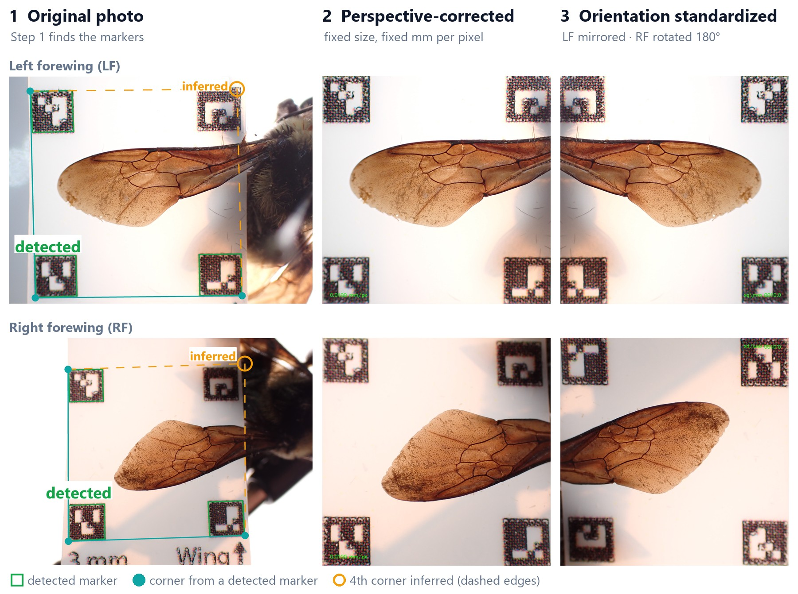

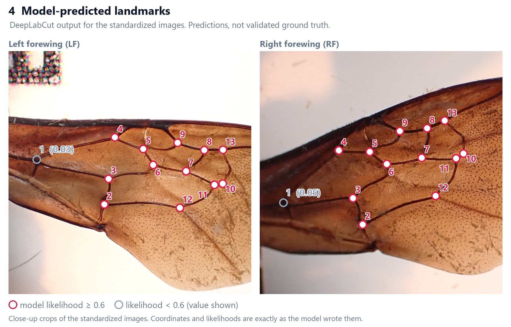

**Full resolution:** [side-by-side LF/RF comparison of all four stages (4483 × 2470)](assets/real/real_pair_full_resolution.jpg)

The pair was run through the real application (Steps 1, 3 and 4), with the trained DeepLabCut model doing the inference. **Nothing in these images was drawn or adjusted by hand.** The marker outlines come from the pipeline's own detector. The landmark positions and confidence values are read straight from the CSV the model wrote.

What the run shows:

- **Step 1 corrected both photos automatically, even though it detected only 3 of the 4 markers on each.** The top-right marker is visible in both photos, but the detector didn't pick it up. The pipeline inferred that corner from the other three (amber ring, dashed edges), so neither photo needed manual correction.
- **Step 3 put both wings the same way round.** The left wing was mirrored and the right wing was rotated 180°. Both now have the base on the left and the tip on the right, so the 13 landmarks line up between them.
- **Step 4 predicted all 13 landmarks on both wings** (2 images in 13.9 s on a laptop CPU, including model load). These are **model predictions, not validated ground truth**. The other 12 on each wing come with likelihood ≥ 0.77. **Landmark 1, near the wing base, comes out at only 0.03 (LF) and 0.05 (RF).** It is drawn as a grey hollow ring rather than hidden. The output keeps the model's own confidence for every point, so weak predictions can be found and checked downstream.

The full coordinate table and the details of how the images were prepared are on **[the real-example page](docs/REAL_EXAMPLE.md)**.

---

## How it works

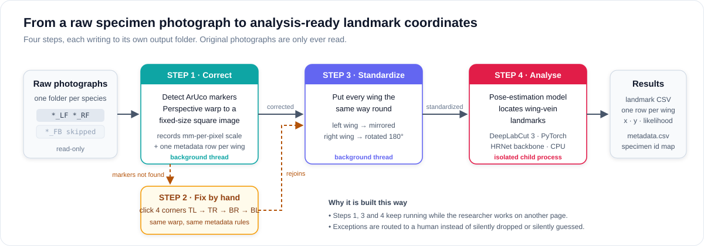

| Step | Computer-vision task | Engineering idea |
|---|---|---|
| **1 · Correct** | Find the ArUco markers on the specimen card and compute the outer quadrilateral, inferring the fourth corner if one marker is missed. Warp it to a fixed square so every pixel has the same physical size. | Runs on a worker thread. Progress comes from the real work, image by image. Metadata writes are idempotent, so re-running never duplicates a row. |
| **2 · Fix by hand** | When markers are hidden, blurred or out of frame, a person clicks the four outer corners and the same warp is applied. | A native canvas whose coordinates are always image pixels, at any window size. After a restart, the queue is rebuilt from what is on disk. |
| **3 · Standardize** | Mirror left wings and rotate right wings 180° so every wing faces the same way before landmarking. | Up-to-date status is checked by filename, not by count. One new image makes the step "out of date" even when the totals match. |
| **4 · Analyse** | A DeepLabCut 3 model (HRNet backbone, PyTorch, CPU) predicts 13 wing-vein landmarks, each with x, y and a confidence value. | Runs in a separate process with a private JSON event channel. Success is checked on disk by the parent. |

### When detection fails (synthetic example)

The real pair didn't need Step 2, so the fallback is shown on a synthetic card.

<table>
<tr>
<td width="50%">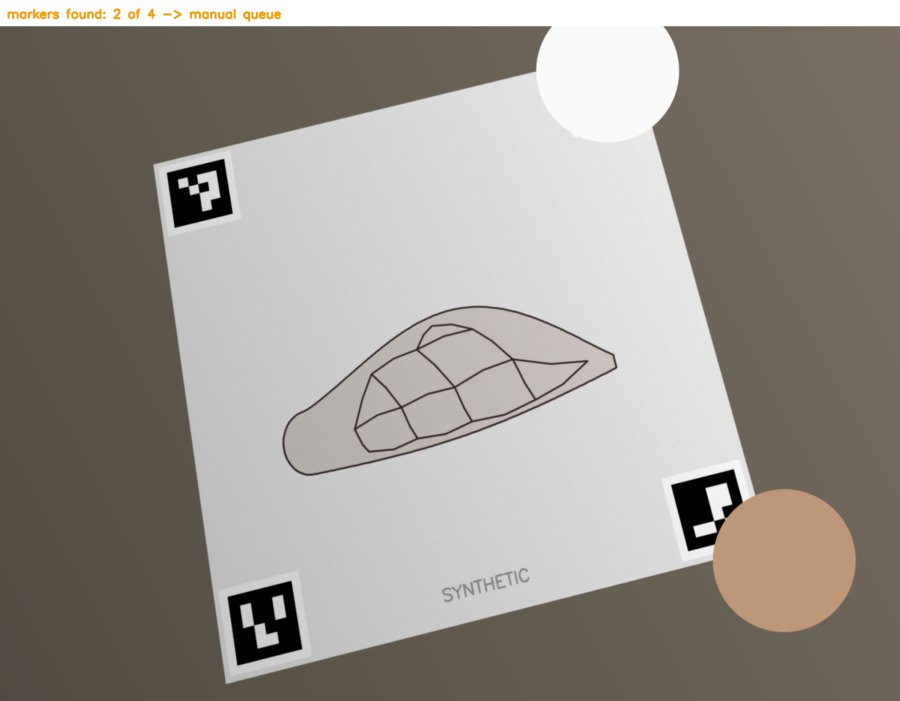 <b>Exception.</b> Glare and a fingertip hide two markers, so the photo goes to the manual queue.</td>
<td width="50%">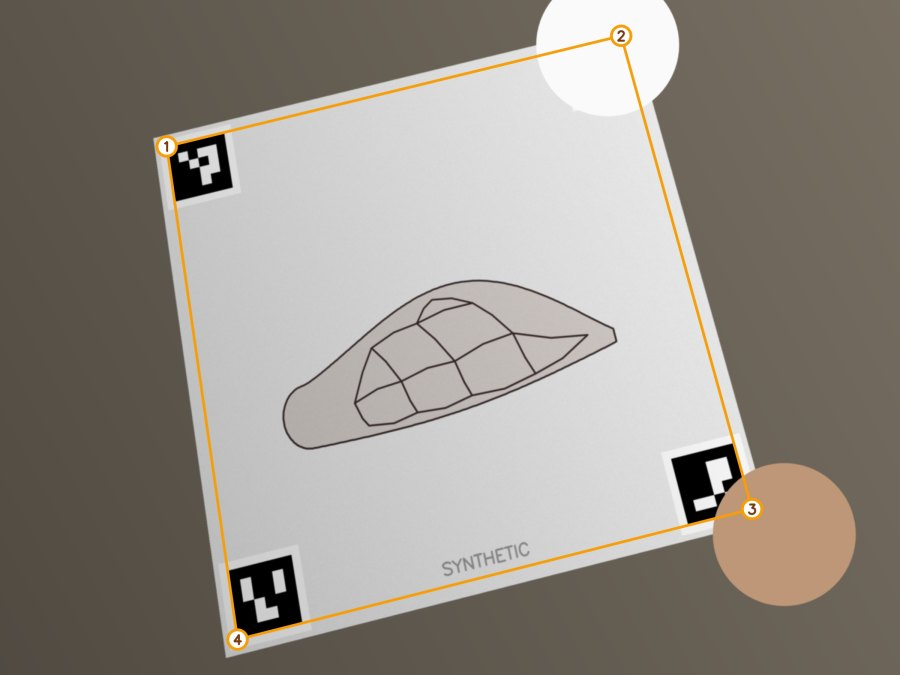 <b>Step 2.</b> A person clicks four corners in a fixed order. The same warp follows.</td>
</tr>
</table>

More pictures, including every application page on a synthetic collection, are in **[the visual walkthrough](docs/WALKTHROUGH.md)**.

---

## The application

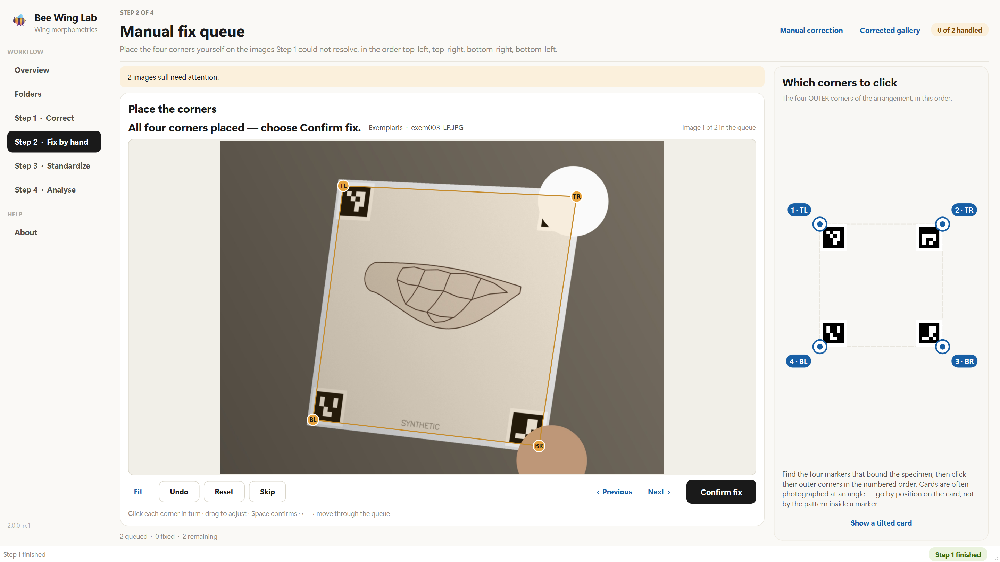

<table>
<tr>
<td width="50%">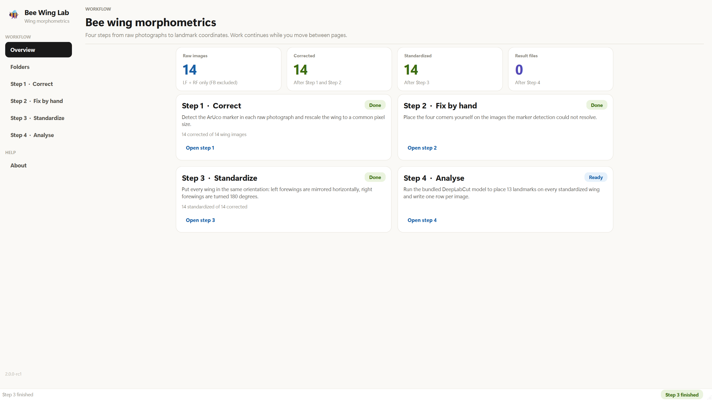 <b>Overview.</b> Counts come from disk, not memory.</td>
<td width="50%">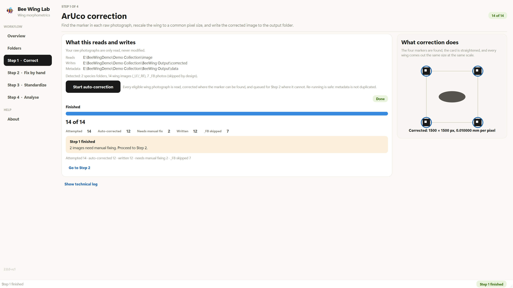 <b>Step 1.</b> 14 attempted, 12 automatic, 2 sent to Step 2.</td>
</tr>
</table>

Screenshots of the real application, captured on the native Windows platform at 1920×1080 against a synthetic 14-wing collection. Paths point at a temporary demo folder, and the model folder is an empty placeholder. The affiliation line in the sidebar was blanked.

---

## Architecture

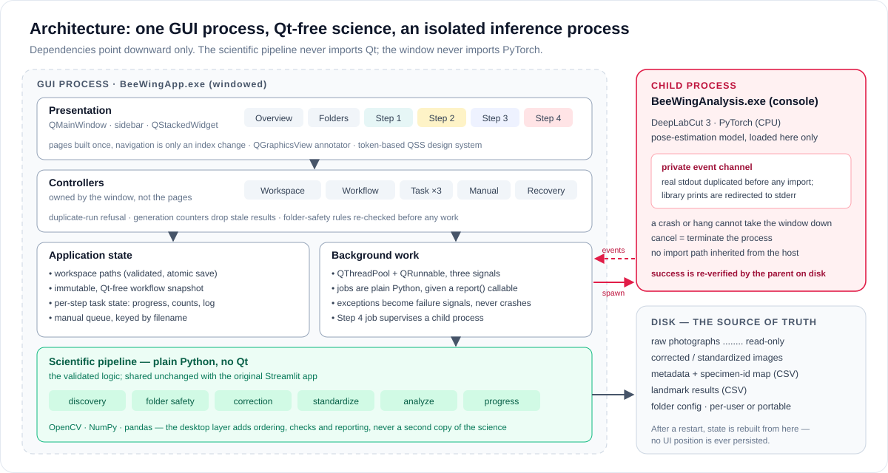

Three rules shape the design. They are explained in **[ARCHITECTURE.md](docs/ARCHITECTURE.md)**.

1. **The science never imports the GUI.** The correction, standardization and analysis code is plain Python, shared unchanged by the original Streamlit app and the new desktop app. That is what made an exact comparison between the two possible.
2. **Navigation can't interrupt work.** Every page is built once. Switching pages only changes a stack index. Long-running steps belong to controllers owned by the window, so a running job doesn't depend on which page is visible.
3. **The disk is the source of truth.** Corrected images, metadata and the specimen-ID map are the record. After a restart, the app rebuilds its state from them. No UI position is ever saved, because a saved position goes wrong the moment anything else changes.

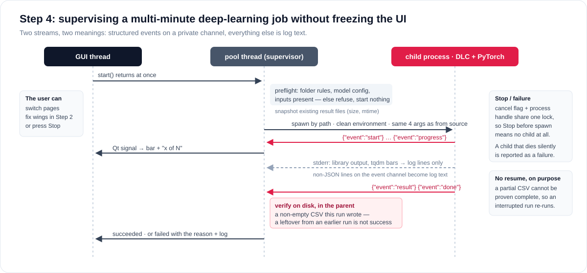

---

## Engineering highlights

Each item is one problem I hit, how I fixed it, and how the fix is checked. Full write-ups are in **[ENGINEERING_DECISIONS.md](docs/ENGINEERING_DECISIONS.md)**.

- **A JSON event channel that a stray `print` can't break.** DeepLabCut prints to stdout and draws progress bars on stderr. The child process copies the real stdout to a private handle before importing anything, then sends `sys.stdout` to stderr. Events and noise can't mix, and a non-JSON line becomes a log line, never progress.
- **"Success" must be proved by a file.** The parent records each result file's size and timestamp before a run. A leftover CSV from an interrupted run doesn't count as success for the next one. Found as a real defect, fixed, and covered by a regression test.
- **A Stop race, closed.** Pressing Stop in the moment before the child process existed used to stop nothing, and the analysis started anyway. The cancel flag and the process handle now share one lock.
- **No "resume" button, on purpose.** DeepLabCut gives no per-image checkpoint, so a partial CSV can't be shown to be complete. A landmark set that might be missing specimens is worse than none, so an interrupted run starts over. A test fails if anyone adds a resume path.
- **Clicked coordinates stay exact.** The photo sits in the scene at native size, unscaled, and only the view transform changes. Clicked points are image pixels at any zoom level. Round-trip tests check this at 0.4×, 1×, 2.5× and 7×.
- **A slow test suite was really a memory leak.** 776 tests took **1,335 s**. Measuring showed the cost growing with each test's position in the run, not with the science. Widgets scheduled for deletion were never destroyed, and every stylesheet change re-styled all of them. One reaping hook brought the same tests, with the same assertions, down to **299 s**.
- **The build checks itself.** A rebuild once shipped stale bytecode: the source changed but kept the same mtime and size, so every cache check passed. Builds now purge caches, fingerprint the source by content, embed the fingerprint, and fail if the built executable reports a different one.
- **Layout checks that actually find clipping.** The old size check gave wrong answers both ways. It was replaced with a geometry audit ("is any text cut off, is any child outside its parent?") that runs on 7 pages × 4 window sizes × 2 states. It found three real defects.

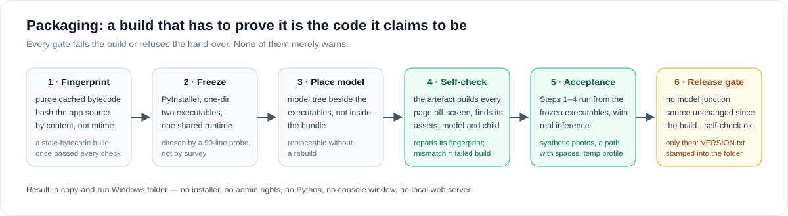

---

## Verified engineering metrics

These numbers come from the project's own test records and from runs I repeated while preparing this page. They are **engineering** measurements, made on synthetic data except for the one real pair. They are not scientific or model-accuracy results: a single pair's confidence values are not a validation, and no accuracy figures are reported here. Where each one comes from is in [TESTING.md](docs/TESTING.md).

| Metric | Value |
|---|---|
| Automated tests (collected) | **1,248** across 34 test modules |
| Last full gate | **1,229 passed, 0 failed**, 2 skipped (opt-in real-model run; one focus test the headless platform can't host) |
| Fast suite, re-run on 2026-10-13 | 1,127 passed, 0 failed, 2 skipped, in 150 s |
| Legacy vs desktop parity | SHA-256 **byte-identical** for every corrected, hand-corrected and standardized image and for the landmark CSV (via a stand-in analysis child), plus row-identical metadata |
| Page switch, idle | **1.03 ms** average over 140 switches |
| Page switch while Step 1 processes a collection | mean 25.2 ms, worst 98.7 ms over 235 switches (budget 250 ms) |
| Workspace scan, 2,100 images | ~209 ms, moved off the GUI thread for that reason |
| Test-suite runtime after fixing the widget leak | 1,335 s → 299 s, same 776 tests |
| Packaged build self-check | 35 checks, 0 failed |
| End-to-end acceptance from the packaged executables | 23 of 23 checks, including real DeepLabCut inference: **70 s for 10 synthetic images** on CPU |
| Real forewing pair through the app (run from source) | 2 of 2 auto-corrected, 2 standardized, 13 landmarks each; Step 4 in **13.9 s** including model load |
| Layout audit | 56 page × size × state combinations, 0 clipping problems |
| Design record | 36 architecture decision records, 3 recorded findings |

---

## My role and how it was built

I built this for a university entomology research workflow, as its sole human developer. I:

- **wrote the original image-processing research code** (marker-based correction, manual fix, orientation) as notebooks;
- **trained the landmark model** that Step 4 runs. The training data, labels, weights and evaluation results stay private;
- **defined and directed the application**, first as a Streamlit app and then as the native desktop app: requirements, the scientific behaviour that must not change, the phase plan, acceptance criteria, and the architecture decision log;
- **made the product decisions** recorded in that log: e.g. no saved queue position, no resume for interrupted analysis, removing zoom from manual correction after using it;
- **reviewed and accepted every checkpoint, and tested each build by hand.** That hands-on testing found defects the automated suite had passed (touchpad zoom, focus-driven scrolling, a silently dead button). Each became a regression test;
- **ran the packaging and verification** of the Windows distribution, and the researcher-facing guide.

**AI-assisted development.** The application was developed with an AI coding agent (Claude Code), which wrote much of its code, tests and project documentation under my direction. 32 of the private repository's 33 commits are co-authored by it. My part was the research code it started from, the model, the requirements and constraints, the decisions, the review, and the testing against real use. I'm stating this plainly because directing and verifying AI-written engineering to this standard is a core part of what this project demonstrates.

---

## What is public and what is private

| Public here | Private (not in this repository) |
|---|---|
| Design, architecture and decision write-ups | Production source code and its git history |
| Diagrams I drew for this page | All other specimen photographs and lab data |
| **One approved real forewing pair** and its genuine outputs (identifiers and metadata removed) | Training images, landmark labels, model weights |
| Synthetic images (a drawn wing on a card with public ArUco markers) | Specimen identifiers, collection metadata, species and dates |
| Screenshots of the app running on synthetic data | Model evaluation and any scientific results |
| Engineering and test metrics | The packaged application and its archives |

## Rights and reuse

No license is offered. The ownership and licensing of the underlying research software are still being confirmed with the research group. This repository is viewable but not reusable; contact me before reusing any part of it.

## Contact

Houchunxiao Xia. Reach me through [my GitHub profile](https://github.com/eddf-XIA).
