# Visual walkthrough (synthetic data)

← [Back to the overview](../README.md)

Everything below was made from **synthetic** inputs. An invented wing is
drawn on a card with four public ArUco markers (OpenCV `DICT_4X4_50`), and a
hand-held photo is simulated. The application screenshots show the real
program processing a 14-wing synthetic collection in a temporary folder.

## The idea, step by step

| | |
|---|---|
| 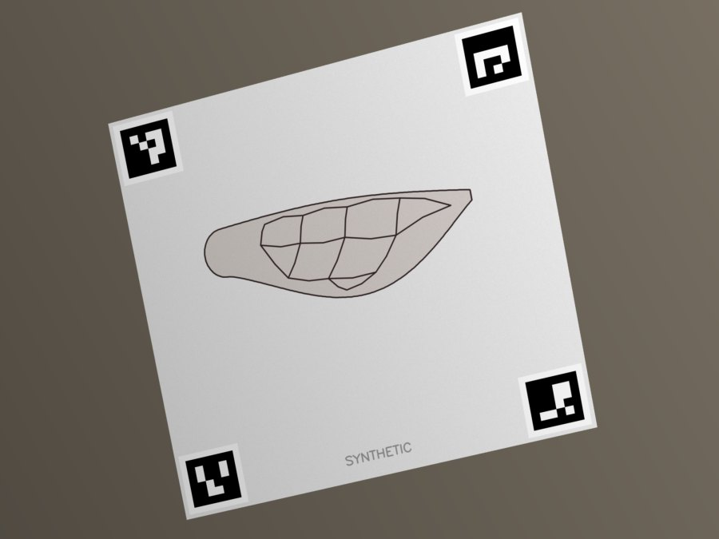 | **Raw photograph.** The card is tilted, seen in perspective, and lit unevenly. The pixel scale differs from photo to photo. |
| 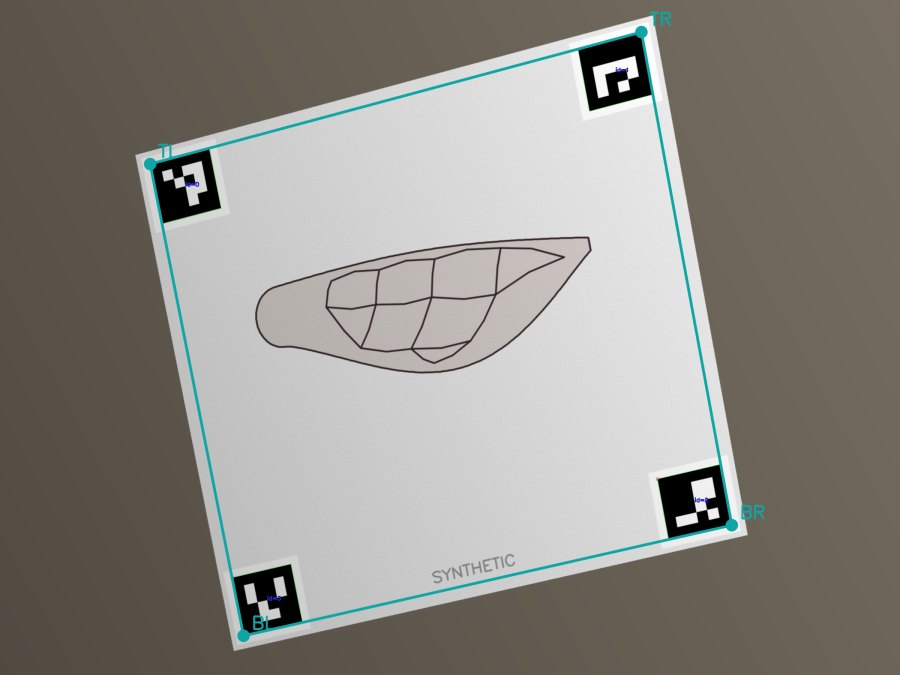 | **Markers detected.** The outer corner of each marker defines a quadrilateral whose real-world size is known. |
| 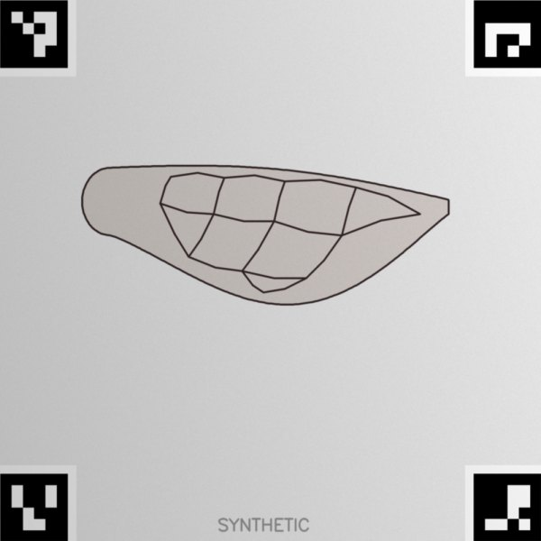 | **Corrected.** A perspective warp maps that quadrilateral to a fixed square, so every corrected image has the same mm-per-pixel scale. |
| 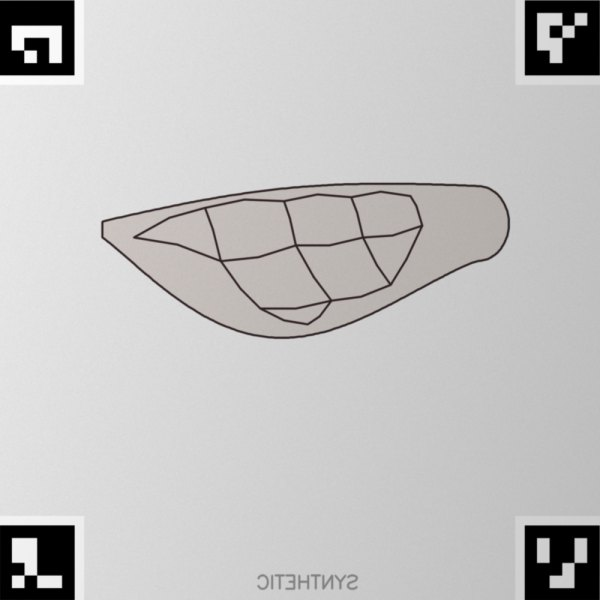 | **Standardized.** A left wing is mirrored, so it faces the same way as every other wing. |
| 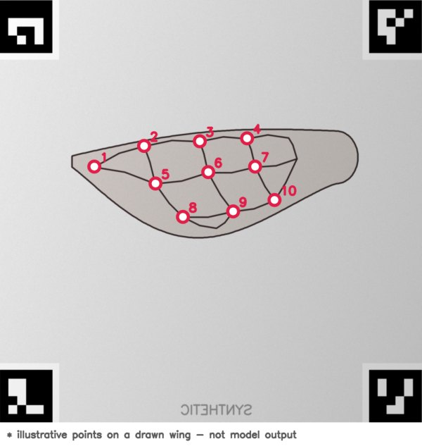 | **Landmarks (illustrative).** In the real application a trained pose-estimation model predicts 13 landmarks per wing. The points here are junctions of the drawn veins, **not model output**. |

### When detection fails

| | |
|---|---|
|  | Glare and a fingertip hide two markers. Rather than guess, the photo goes to a queue for a person. |
|  | The researcher clicks the four outer corners in a fixed order: top-left, top-right, bottom-right, bottom-left. |
| 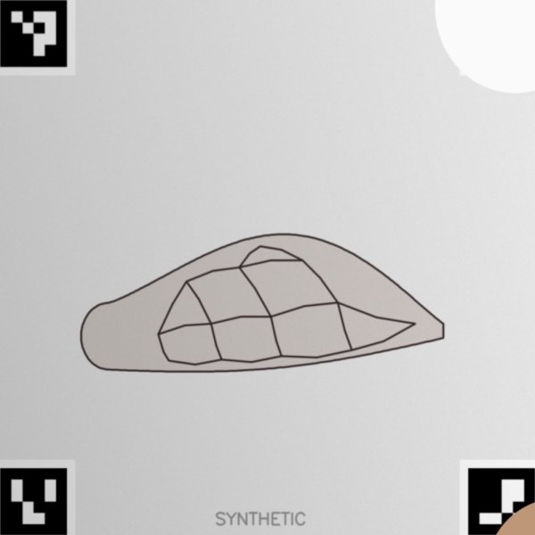 | The same warp produces the corrected image. |
| 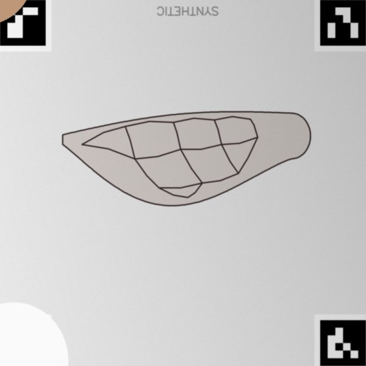 | A right wing is rotated 180° to match. |

## The application

Captured from the real program on the native Windows platform at 1920×1080.
The only change was blanking the affiliation line in the sidebar. The model
folder is an empty placeholder, so no inference is shown.

### Folders: one choice, safe by construction
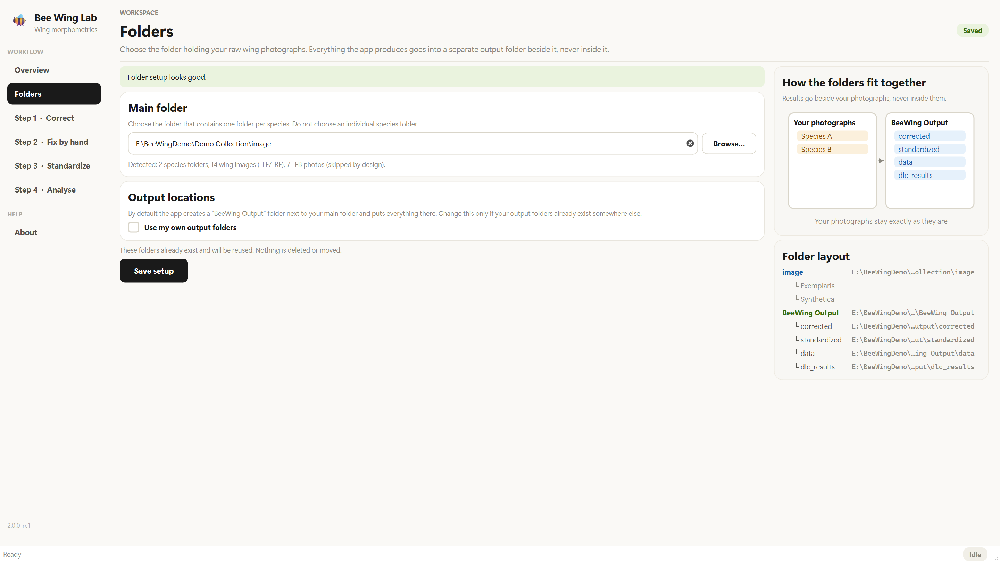

The researcher picks only the folder that holds the per-species folders. Every
output goes into a sibling `BeeWing Output` folder. A layout where outputs
would overlap the photographs can't be saved, and the reason is shown.

### Overview: counts from disk

### Step 1: automatic correction

14 wing photos attempted: 12 corrected automatically, 2 sent to Step 2, and 7
full-body photos skipped by design.

### Step 2: manual correction

Four corners placed on a photo whose markers were hidden. The guide teaches
corner order by *position on the card*, not by marker pattern, so it still
works on a rotated card.

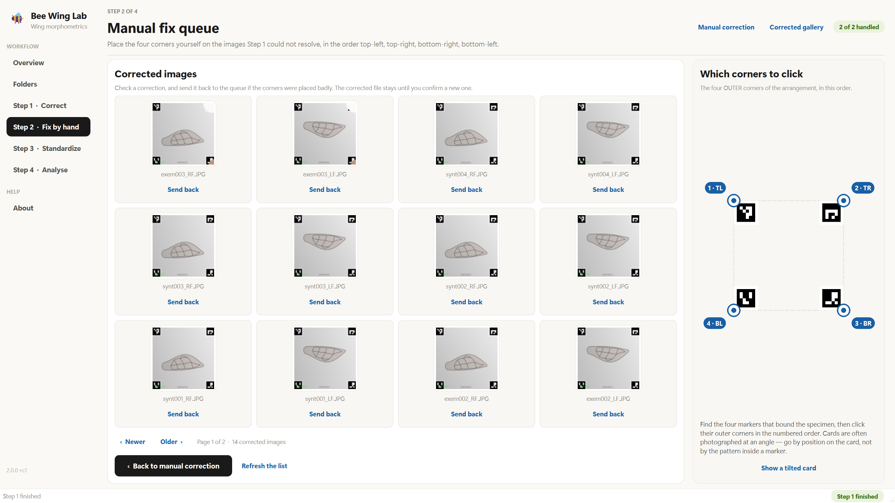

The corrected-image gallery. Any correction can be sent back to the queue
without deleting the existing file.

### Step 3: orientation
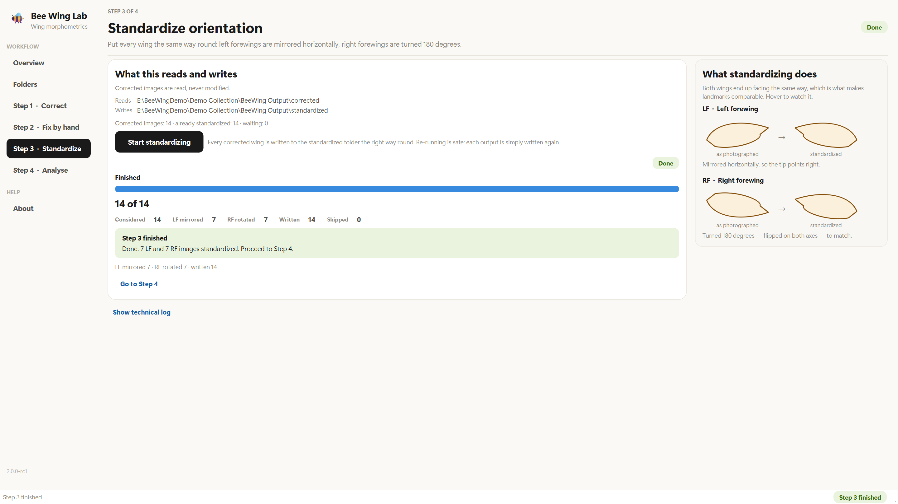

### Step 4: landmark analysis
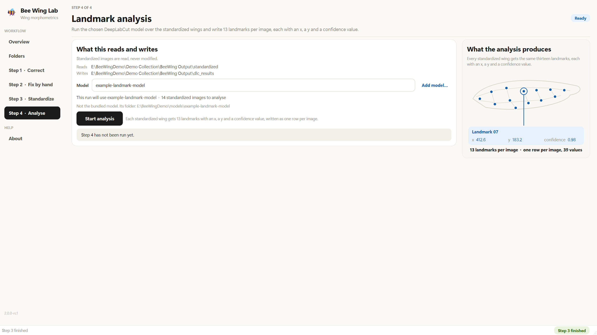

The page states which model a run will use. Here it is a placeholder folder,
because no real model is included. The readout on the right is part of the
app's built-in illustrated guide, not a result.
